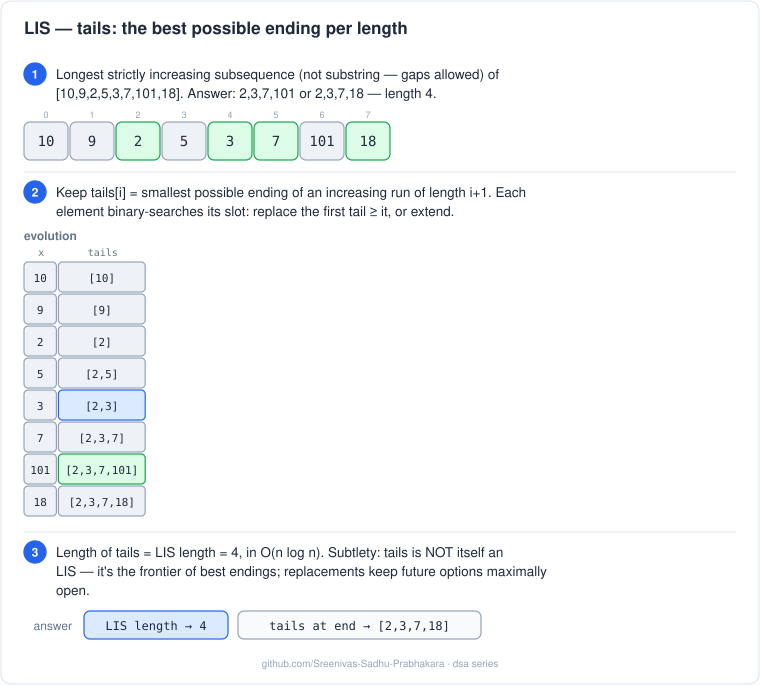

# Longest Increasing Subsequence

> Striver SDE Sheet 171 · Day 25 DP — the tails array: smallest possible tail per subsequence length, kept sorted so binary search places each element. Go, stdlib only, tested.

## Problem

The length of the longest strictly increasing subsequence (not necessarily contiguous). The O(n²) DP is the textbook answer; this is the O(n log n) one interviewers upgrade to.

## Approach

Maintain `tails`, where `tails[k]` is the smallest value that can end an increasing subsequence of length k+1. The two facts that make it work: tails is always sorted (a longer subsequence can't have a smaller best tail), and each new element does exactly one thing — extends the longest subsequence (append) or makes some length cheaper to extend later (replace the first tail ≥ it, found by binary search). The subtle honesty: tails is *not* an actual subsequence, only its length is meaningful — recovering the sequence itself needs parent tracking. Duplicates don't chain because `SearchInts` finds ≥ (for non-decreasing LIS, search > instead).

**Complexity:** O(n log n) time, O(n) space.

## Visual walkthrough

Read the picture top to bottom — each numbered frame is one moment of the algorithm
running on this repo's test example.

## Run

    go test ./...   # verify
    go run .        # demo

---

One of 191 repos solving Striver's SDE Sheet in Go — stdlib only, one problem per repo, every solution tested. Browse the set: [`dsa-*` repos](https://github.com/Sreenivas-Sadhu-Prabhakara?tab=repositories&q=dsa-&type=source).
